# If Life Moments

**A Junction X 2026 prototype for the If Insurance challenge.** Life Moments helps people *before* a
big life decision instead of after something goes wrong. You tell it where you are moving, where you
are travelling or what your pet needs. It checks that against Finnish and international open data,
shows the risks in plain language and turns them into a plan you can tick off.

This repository holds the documentation and screenshots. The code is in
[**Qumetri/JunctionX2026Project**](https://github.com/Qumetri/JunctionX2026Project) (branch `dev`).

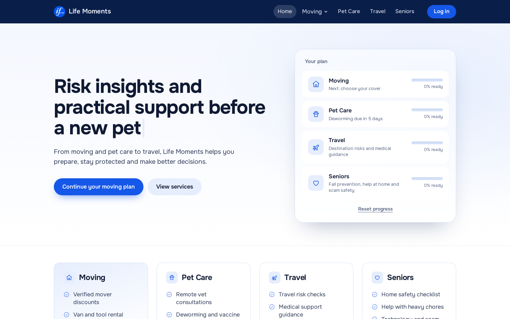

## Contents

- [What it does](#what-it-does)
- [Moving](#moving)
- [Travel](#travel)
- [Pet Care](#pet-care)
- [Seniors](#seniors)
- [Member benefits](#member-benefits)
- [On a phone](#on-a-phone)
- [How the risk score works](#how-the-risk-score-works)
- [Where the data comes from](#where-the-data-comes-from)
- [The AI summary](#the-ai-summary)
- [Architecture](#architecture)
- [Tools and technologies](#tools-and-technologies)
- [Run it yourself](#run-it-yourself)
- [Status and limits](#status-and-limits)

## What it does

Insurance usually comes up only when you buy a policy or file a claim. Life Moments brings it in
earlier, at the moments when people make decisions: moving home, a trip abroad, a new pet, an older
relative living alone. For each moment it:

1. **Checks real data** about the address, the dates and the destination, such as building age,
   flood areas, crime rates, weather, travel advice and disaster alerts.
2. **Scores the risk from 0 to 100** and explains every point. Each risk shows its point lines, so
   nothing is a black box.
3. **Suggests the right If cover level** and shows which of your risks that level pays for and
   which it doesn't.
4. **Turns the risks into actions:** a step-by-step plan, dated checklists and partner help, saved
   in the browser so you can come back to it.

Everything runs in the visitor's browser: no account and no database. Answers and progress are kept
in `localStorage`, and **Reset progress** on the home page clears them.

## Moving

The fully built journey. Enter the new address (and optionally the old one), the moving date, the
home's size and type, and a few yes/no answers: moving yourself, fragile or valuable items, ground
floor, renting, a dog, existing home insurance.

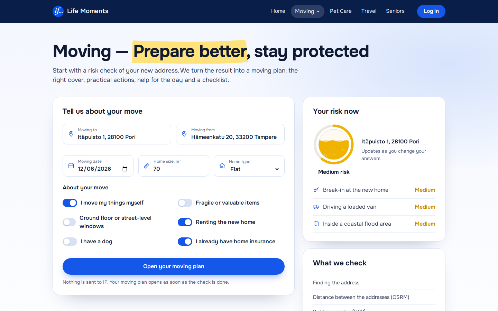

- **Address suggestions while you type** (Photon). The exact address is geocoded only when you
  press **Calculate risk** (Nominatim), as that service's usage policy asks.
- **Your risk now** updates as you change answers; only a new address or date fetches data again.
- **What we check** lists every data source and its status as the answers arrive. A source that
  fails or times out is marked "no answer", and only the risks that need it drop out.

**The moving plan** has four steps: choose your cover, recommended actions, partners and help, and a
moving-day checklist. Beside the steps sit your risks, the liquid risk ring and the route map with
the driving distance and time.

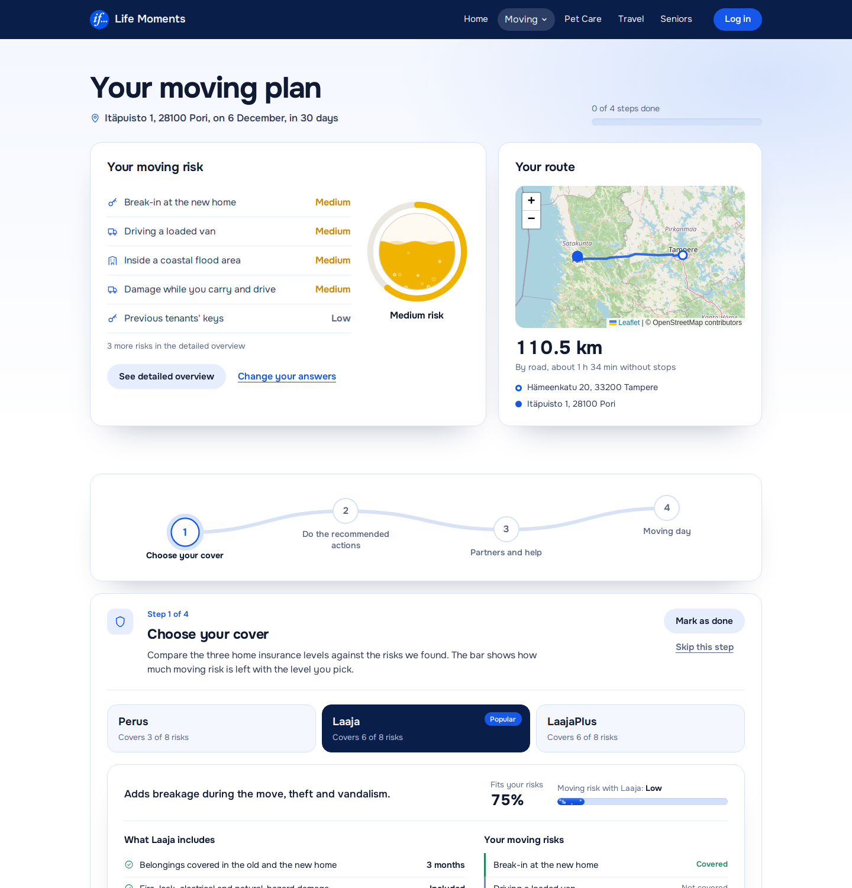

- **Choose your cover** compares If's three home insurance levels (Perus, Laaja, LaajaPlus). For
  each it shows how well it fits your risks and how much moving risk is left with it, and it marks
  the suggested level.
- **Recommended actions** are tied to the risks found. For example, a 1961 building suggests leak
  sensors and asking when the pipes were last renewed. A rental suggests changing the lock cylinder
  and counting keys at handover.

**The detailed risk overview** shows where every point comes from. It also checks your protection
gaps against the suggested level and gives an **In short** summary in plain language.

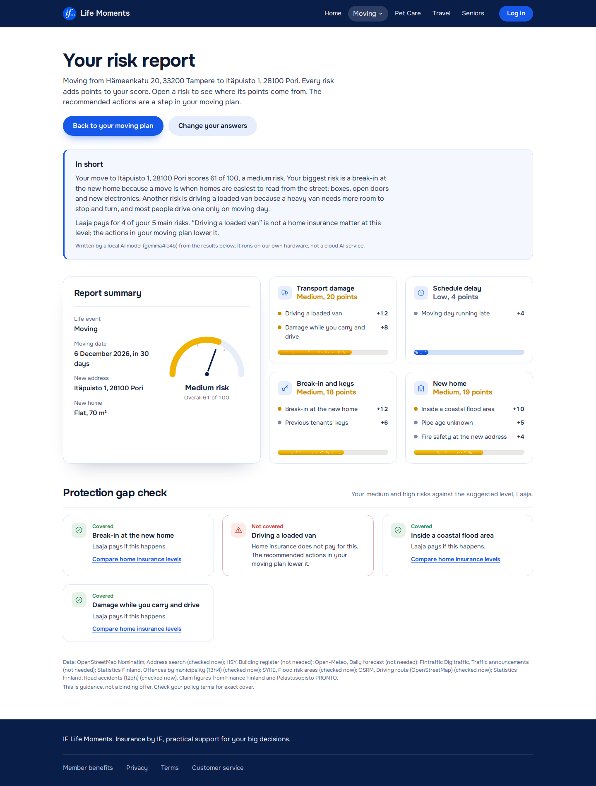

## Travel

Pick a destination (eight to choose from, from Tallinn to Tokyo), the purpose, the dates, whether a
pet comes along and whether you already have travel insurance.

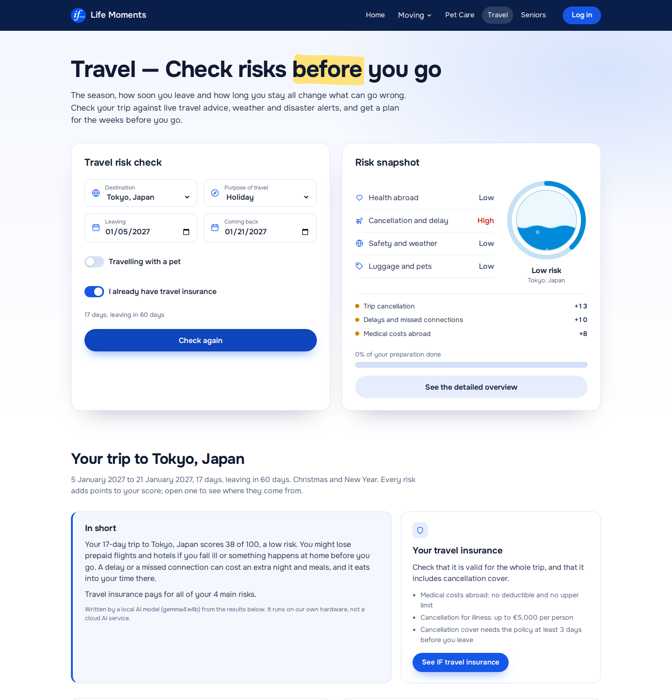

- Points come mostly from the **season** (winter at Helsinki Airport, flu season, holiday peaks),
  the **weather on your dates**, **how soon you leave** and **how long you stay**.
- **UK FCDO travel advice** and **GDACS disaster alerts** for the destination add their own risks.
  Finland's um.fi has no API, so the page links to it.
- A cover card explains fixed-term versus continuous travel insurance.
- **Tips for this trip** are tailored by the AI model from the expert tips of your biggest risks.
- **Before you go** is a drag-and-drop board of tasks, each with a date worked out from your
  departure.

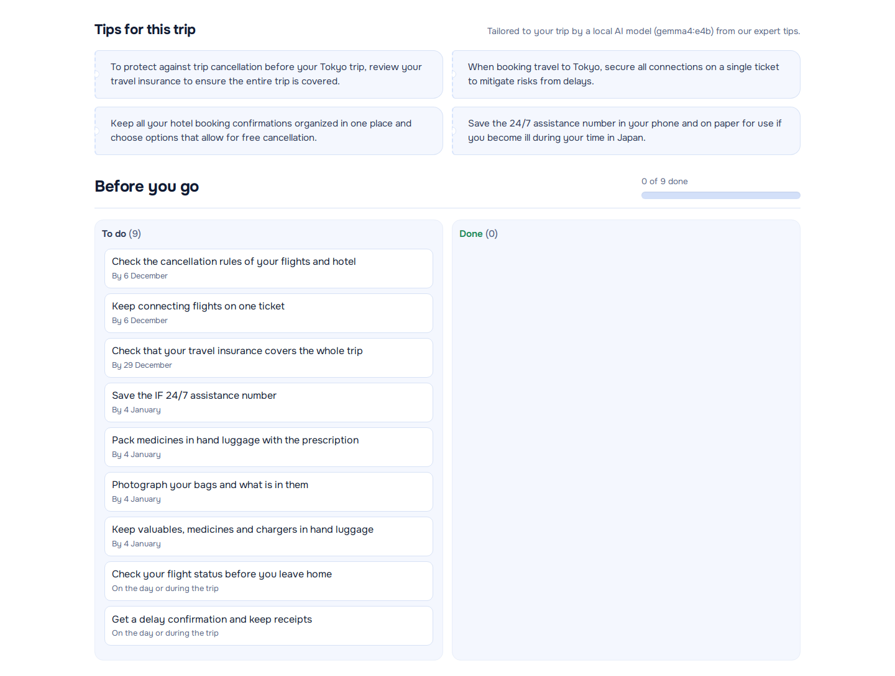

## Pet Care

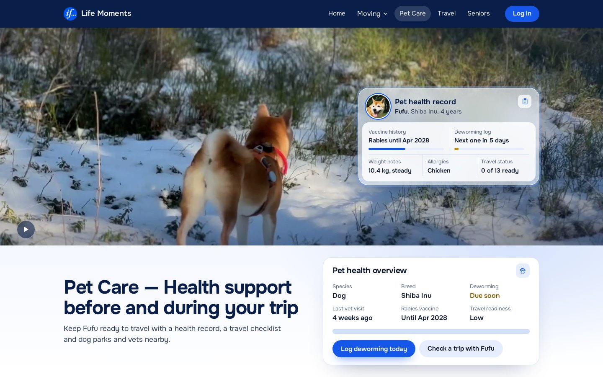

- A **health record** for the demo dog: vaccines, deworming log, weight and allergies. **Log
  deworming today** resets the reminder.
- A **pet travel checklist** with Finnish entry rules, such as the tapeworm treatment 1–5 days
  before coming home.
- **Dog parks and vets within 3 km** on a map. The search is centred on the new home after a
  moving check, on central Helsinki otherwise, or on you with **Use my location**. Free Overpass
  servers are often busy, so three are tried in turn, and then a bundled copy covering all of
  Finland answers.

## Seniors

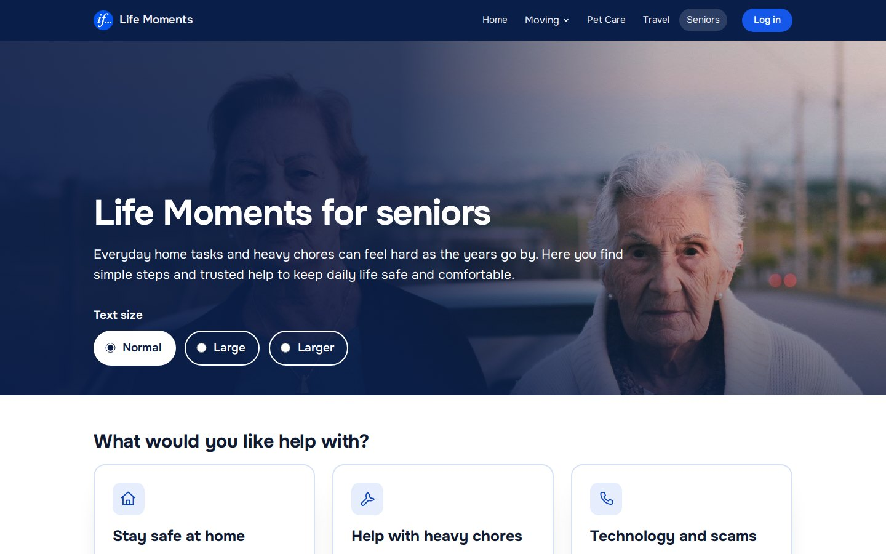

Home safety, help with heavy chores, and technology and scams, as checklists with "who can help"
notes. The page is built for older readers: a **text-size control** (Normal, Large, Larger), big
tap targets and strong focus rings.

## Member benefits

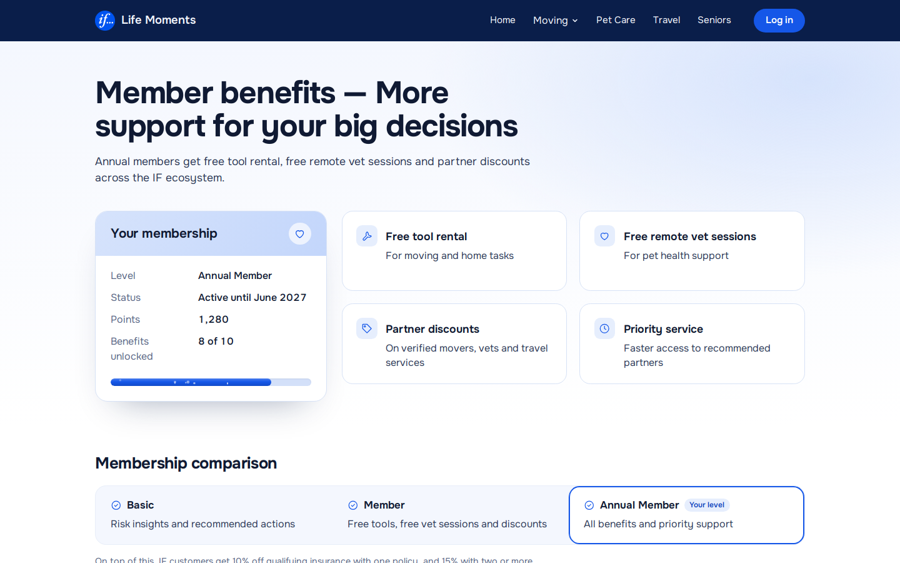

A demo of the membership layer behind the business model: free tool rental for moving, free remote
vet sessions, partner discounts and priority service. Three levels are compared: Basic, Member and
Annual Member.

## On a phone

The whole site is responsive. It was checked in iPhone (WebKit) and Android (Chrome) emulation.

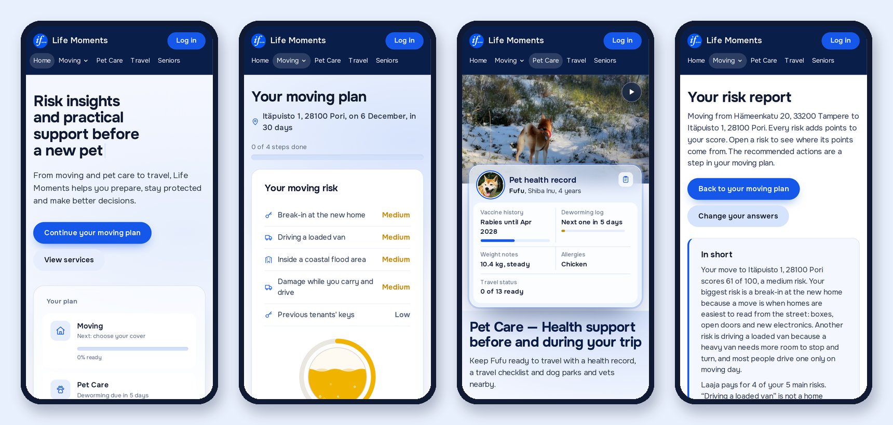

## How the risk score works

The risk engine is plain TypeScript with no React (`shared/engine/`), so it can move to a server
later without changes.

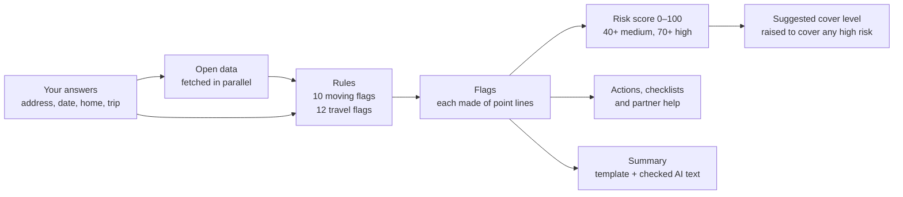

- Each risk is a **flag** made of point lines, for example *"+12 Burglary rate 1.6× the national
  rate"* and *"+4 Windows at street level"*.
- The points add up to the **risk score** from 0 to 100.
- The **suggested plan** follows the risk level. It is raised when only a higher level covers one of
  your high risks.

The score is shown as liquid that fills a glass. The colour runs from blue through yellow to red,
and the liquid flows faster and starts to boil as the risk goes up:

<p align="center">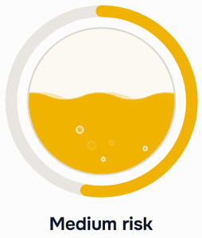</p>

## Where the data comes from

All sources are free and need no API key. The browser calls most of them directly.

| Source | Used for |
| --- | --- |
| OpenStreetMap **Photon** / **Nominatim** | Address suggestions / address → coordinates |
| **HSY** building register | Building year and heating (Helsinki, Espoo, Vantaa, Kauniainen) |
| **SYKE** | Flood risk areas |
| **Statistics Finland** | Burglary, arson and road-accident rates against the national rate |
| **Open-Meteo** | Moving-day forecast, weather on travel dates (archive for trips over 16 days away) |
| **OSRM** | Driving distance and time between the old and the new home |
| **Fintraffic Digitraffic** | Traffic announcements near the address in the week of the move |
| **UK FCDO** | Travel advice for the destination country |
| **GDACS** | Current disaster alerts near the destination |
| OpenStreetMap **Overpass** | Dog parks and vets near a point |
| Finance Finland, Pelastusopisto PRONTO, EUROCONTROL | Average claim sizes and airport delays (built-in figures) |

Answers are cached in the browser, so going back and forth doesn't call the services again.

## The AI summary

The **In short** text and the travel **Tips for this trip** can be written by a language model running
on our own hardware, through Ollama. In the deployed version this is Google's `gemma4:e4b`. It was
picked by running the app's own checks on ten moving and travel cases against four other small
models. It passed every check and stuck most closely to the facts it was given.

The model is never trusted blindly:

- The score and the plan sentences are always written by code. The model may only rephrase the
  risk sentences.
- Its answer is checked: **no new numbers, no insurance promises, length limits.** If a check fails,
  or no model is reachable, the page uses the template text instead.
- On the server, the page talks only to a small guarded proxy, never to Ollama itself. The proxy
  accepts only the one model, caps input and output, limits requests per visitor and per day, and
  queues requests because the GPU is shared.

## Architecture

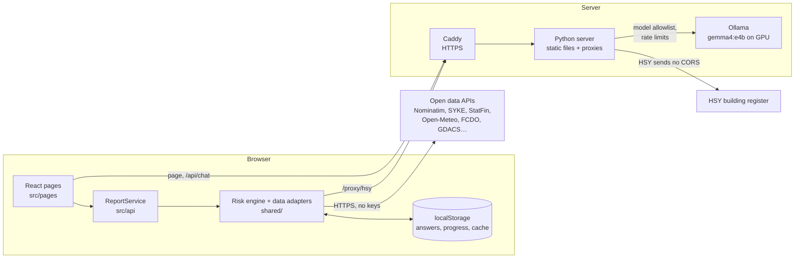

- **Static single-page app.** A production build is a folder of files. The only server-side parts
  are two same-origin proxies:
  - **HSY**, because HSY's API sends no CORS headers;
  - **the AI model**, because a browser can't reach a model running on our own machine.
- **One way in.** `src/api/ReportService` is the only door from the UI to `shared/`, so the engine
  can later run behind a real backend.
- **Deployment:**
  - a multi-stage Docker image: `node:22-alpine` builds, `python:3.12-slim` serves;
  - the container runs read-only as a non-root user with all capabilities dropped and 256 MB of RAM;
  - Caddy terminates TLS in front of it.

## Tools and technologies

| Area | Tools |
| --- | --- |
| Language | **TypeScript** (strict) everywhere in the app |
| UI | **React 19**, plain CSS with custom properties and `color-mix(in oklch)`, no UI kit |
| Build | **Vite 8**; the build runs `tsc -b` first, so a type error fails it |
| Maps | **Leaflet 1.9** with OpenStreetMap tiles |
| Inputs and interaction | **Downshift** (address combobox), **@hello-pangea/dnd** (drag-and-drop boards), **react-rough-notation** (hand-drawn highlight), **typewriter-effect** (home page headline) |
| Code quality | **ESLint 10** with typescript-eslint and the React Hooks rules, **Prettier** |
| AI | **Ollama** with `gemma4:e4b` in production (`qwen2.5:3b` by default for local development) |
| Server | **Python 3.12** standard library (static files, guarded AI and HSY proxies, unit tests), **Docker**, **Caddy** |
| Design | Mockups in the code repo's `Design/` folder; a component demo page (`component-demo/`) used while building |
| Assistance | **Claude Code** was used for parts of the implementation, the deployment and this documentation |

Every animation respects `prefers-reduced-motion`. With reduced motion, the liquid stands still,
the headline doesn't type and the walk video starts paused.

## Run it yourself

Needs Node 20.19+ or 22.12+.

```bash
git clone -b dev https://github.com/Qumetri/JunctionX2026Project.git
cd JunctionX2026Project
npm install
npm run dev        # http://localhost:5173; also starts Ollama and the model if installed
npm run dev:web    # Vite only, no AI (the summary uses the template)
npm run build      # type-check + production build to dist/
npm run lint
```

In development, Vite proxies `/proxy/hsy` to HSY and `/proxy/ollama` to a local Ollama. Without
Ollama the app still works and shows the template summary.

**Demo addresses** for each risk level (moving on a date about a month ahead):

| Address | Answers | Score |
| --- | --- | --- |
| Hämeenkatu 20, Tampere | Flat, upper floor, movers, home insurance | ~18, low |
| Hakunilantie 48, Vantaa | Same | ~40, medium |
| Itäpuisto 1, Pori (from Tampere) | Renting and moving yourself | ~61, medium |
| Mannerheimintie 10, Helsinki | Ground floor, renting, moving yourself, valuables, dog, no home insurance | ~100, high |

Scores move with the date and the open data, for example when the move falls at the end of the
month or in winter.

## Status and limits

This is a hackathon prototype, not an If product.

- **Not built yet:**
  - an offline demo mode with saved snapshots of the demo addresses;
  - automated tests for the rules and data parsers;
  - more travel destinations;
  - real pet profiles;
  - login and real quotes. "Get a quote" links go to if.fi.
- **To confirm with If:** the plan perks and limits were read from if.fi's public pages, and the
  point values are the team's own assumptions. Partner offers in the action lists are placeholders,
  except the confirmed If benefits.
- **Guidance only:** every result page says it is guidance, not a binding offer.

## Team

Built at **Junction X 2026** for the If Insurance challenge by
[@Qumetri](https://github.com/Qumetri) and [@FelixLiu339](https://github.com/FelixLiu339).
